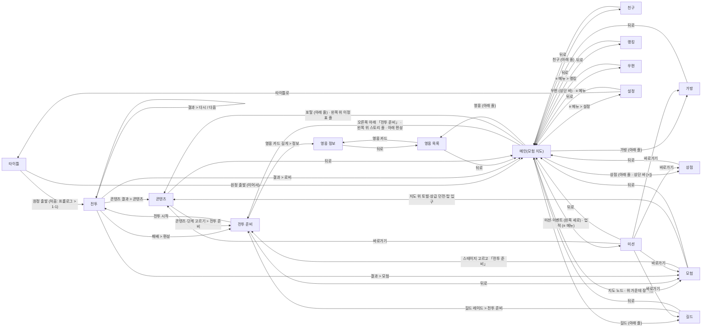

# 화면 흐름도 (자동 생성 · tests/flow.test.ts)

- 첫 실행 → 첫 전투: **2탭** (타이틀 「원정 출발」 → 1-1 필드에서 프롤로그 5줄, 스킵 1탭 또는 5탭 → 전투 시작)
- 첫 전투 승리 → 「원정대 여관으로」 1탭 → 로비
- 원칙: 주요 기능 1탭 · 모든 기능 3탭 이내 (STAR_PLAN_v2 최상위 원칙)

| 화면 | 로비에서 탭 수 | 이 화면에서 갈 수 있는 곳 (누르는 것) |
|---|---|---|
| 타이틀 | 2 | 전투 (원정 출발 (처음: 프롤로그 > 1-1)) 메인(모험 지도) (원정 출발 (이어서)) |
| 메인(모험 지도) | 0 | 모험 (지도 노드 · 위 가운데 장 이름) 전투 준비 (오른쪽 아래 「전투 준비」 · 왼쪽 위 스토리 줄 · 아래 편성) 콘텐츠 (포탈 (아래 줄) · 왼쪽 위 이정표 줄) 영웅 목록 (영웅 (아래 줄)) 가방 (가방 (아래 줄)) 상점 (상점 (아래 줄 · 상단 바 [+])) 친구 (친구 (아래 줄)) 길드 (길드 (아래 줄)) 미션 (미션·이벤트 (왼쪽 세로) · 업적 (≡ 메뉴)) 랭킹 (≡ 메뉴 > 랭킹) 우편 (우편 (상단 바) · ≡ 메뉴) 설정 (≡ 메뉴 > 설정) |
| 모험 | 1 | 전투 준비 (스테이지 고르고 「전투 준비」) 콘텐츠 (지도 위 토벌·상급 던전·탑 입구) 메인(모험 지도) (뒤로) |
| 전투 준비 | 1 | 전투 (전투 시작) 영웅 정보 (영웅 카드 길게 > 정보) 모험 (뒤로) |
| 전투 | 2 | 콘텐츠 (콘텐츠 결과 > 콘텐츠) 메인(모험 지도) (결과 > 로비) 모험 (결과 > 모험) 전투 (결과 > 다시 / 다음) 전투 준비 (패배 > 편성) |
| 영웅 목록 | 1 | 영웅 정보 (영웅 카드) 메인(모험 지도) (뒤로) |
| 영웅 정보 | 2 | 영웅 목록 (뒤로) |
| 가방 | 1 | 메인(모험 지도) (뒤로) |
| 상점 | 1 | 메인(모험 지도) (뒤로) |
| 콘텐츠 | 1 | 전투 준비 (콘텐츠·단계 고르기 > 전투 준비) 메인(모험 지도) (뒤로) |
| 미션 | 1 | 모험 (바로가기) 콘텐츠 (바로가기) 상점 (바로가기) 가방 (바로가기) 길드 (바로가기) 메인(모험 지도) (뒤로) |
| 길드 | 1 | 전투 준비 (길드 레이드 > 전투 준비) 메인(모험 지도) (뒤로) |
| 친구 | 1 | 메인(모험 지도) (뒤로) |
| 랭킹 | 1 | 메인(모험 지도) (뒤로) |
| 우편 | 1 | 메인(모험 지도) (뒤로) |
| 설정 | 1 | 타이틀 (타이틀로) 메인(모험 지도) (뒤로) |

아직 없는 화면(1단계 B·C·D덩어리에서 생김): 가방 · 상점 · 미션 · 업적 · 친구 · 길드 · 랭킹 · 우편 · 채팅 창 · 월드 보스 · 레이드 — 로비에서 모두 1탭 자리(아래 줄·오른쪽 큰 버튼)는 이미 있음
